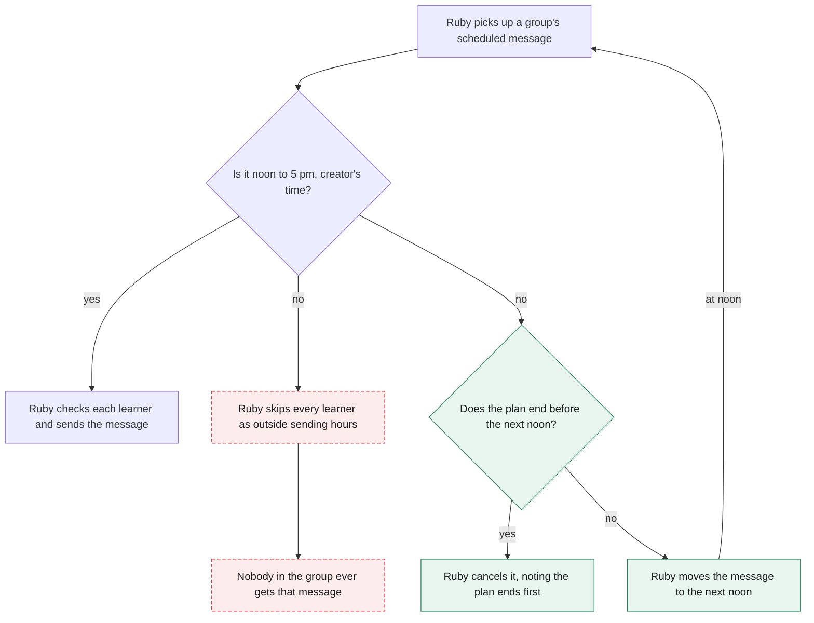
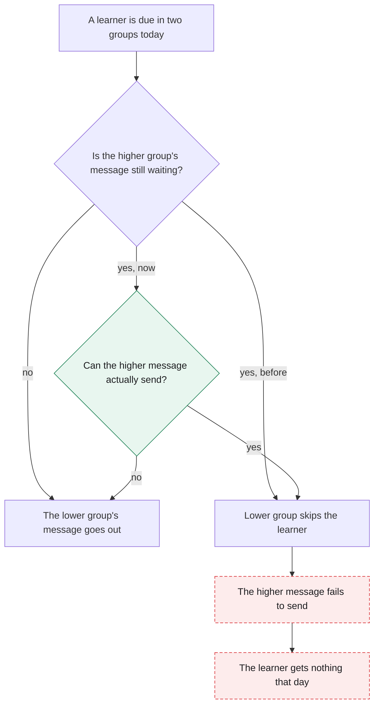
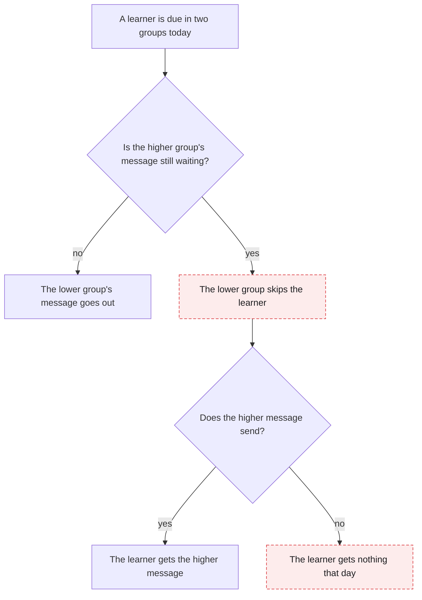
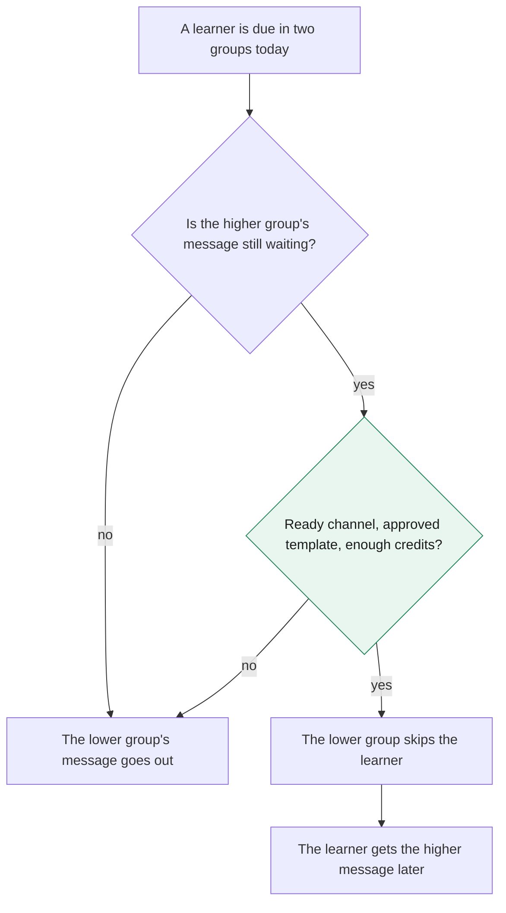

# Worked examples

Real stories written from TagMango backend pull requests. Each block shows the title on its first line, then the body. Copy the shape, never the content.

## Example 1: layout (a), one chart

Good: one chart shows the old dead end in red and the new branches in green, and every box is a step a person would recognise.

~~~~markdown
fix(conversion): Ruby now waits for sending hours instead of dropping a late message

<!-- layers:story v1 -->

**Applies to:** Plans already running too: any message picked up late after this ships is moved.

**Existing data:** Messages already lost to late pickups stay lost. Nothing stored is changed or backfilled.

**Who notices:** Learners get a message picked up late at the next noon instead of never.

Listen

Sometimes Ruby picks up a scheduled message outside sending hours, which run from noon to 5 pm. Until now she skipped every learner, so the message was lost. Now she moves it to the next noon and tries again then. If the plan ends or is stopped before that noon, she cancels the message instead.

<!-- /layers:story -->
~~~~

## Example 2: layout (c), groups

Good: a rename has no flow to draw, so short groups quote the exact words creators now see and say plainly what stays the same.

~~~~markdown
fix: Creators now see "Mango for Learners" instead of "Learning Buddy"

<!-- layers:story v1 -->

#### What creators see now
- "Mango for Learners" wherever "Learning Buddy" used to appear
- Approval card names the channel "Mango for Learners"
- Before, that card showed a raw internal code
- "Mango for Learners is paused for this account"

#### Where the new name shows
- Plan approval cards and blocked-message warnings
- Failure notes in scheduled sends
- Paused, disabled and not-enabled error messages
- Developer API docs for knowledge docs

#### What stays the same
- Email and WhatsApp labels unchanged
- Stored data and internal names untouched
- Name lives in one place for future renames

**Applies to:** Creators using Mango AI conversion plans, the learner assistant, or knowledge docs.

**Existing data:** Nothing changes; stored records keep their old internal values.

**Who notices:** Creators: approval cards, warnings, errors and Ruby's replies now say "Mango for Learners".

Listen

This renames the learner assistant for creators. Everywhere a creator used to see "Learning Buddy", or a raw internal code on the plan approval card, they now see "Mango for Learners". Ruby is told to use the new name and never the old one. Email and WhatsApp labels, stored data and internal names are unchanged.

<!-- /layers:story -->
~~~~

## Counter-example: one tangled chart that should have been layout (b)

Bad: old and new share most steps, so edges labelled "yes, before" and "yes, now" cross into one shared box and the reader cannot tell which path is which.

~~~~markdown
fix(conversion): A higher group takes a learner's day only if it can send

<!-- layers:story v1 -->

~~~~

The same change as layout (b). Good: the Before chart ends in the red dead end, the Now chart adds one green check, and neither needs "before" or "now" on an edge.

~~~~markdown
fix(conversion): A higher group takes a learner's day only if it can send

<!-- layers:story v1 -->

**Before**

**Now**

**Applies to:** Running plans too, from the next send. No automated test covers this check.

**Existing data:** Nothing stored changes; days already lost are not resent.

**Who notices:** Learners due in two groups get the lower group's message when the higher cannot send.

Listen

When a learner is due in two groups on the same day, the higher group's waiting message used to hold their one daily slot, even if it then failed to send, so they got nothing. Now Ruby first checks that the higher message can send. If its channel, template or credits fall short, the lower group's message goes out instead.

<!-- /layers:story -->
~~~~
